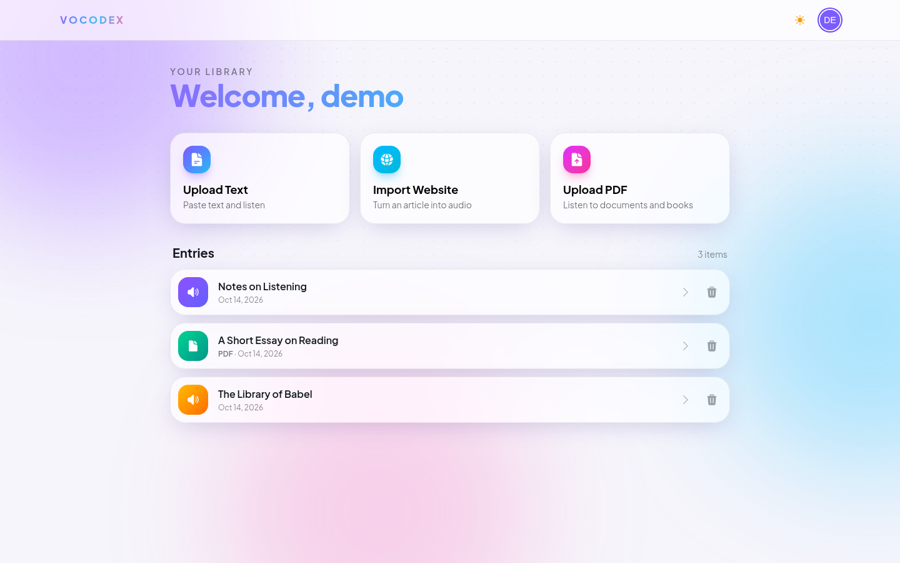
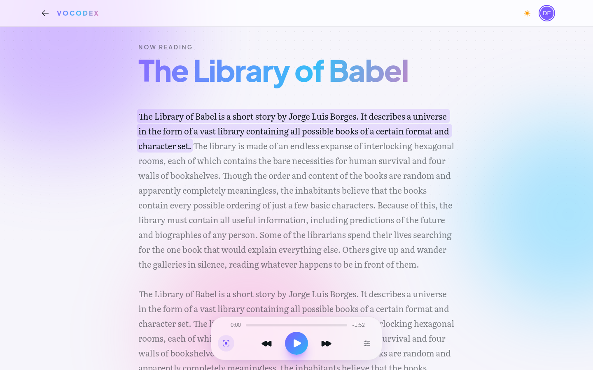
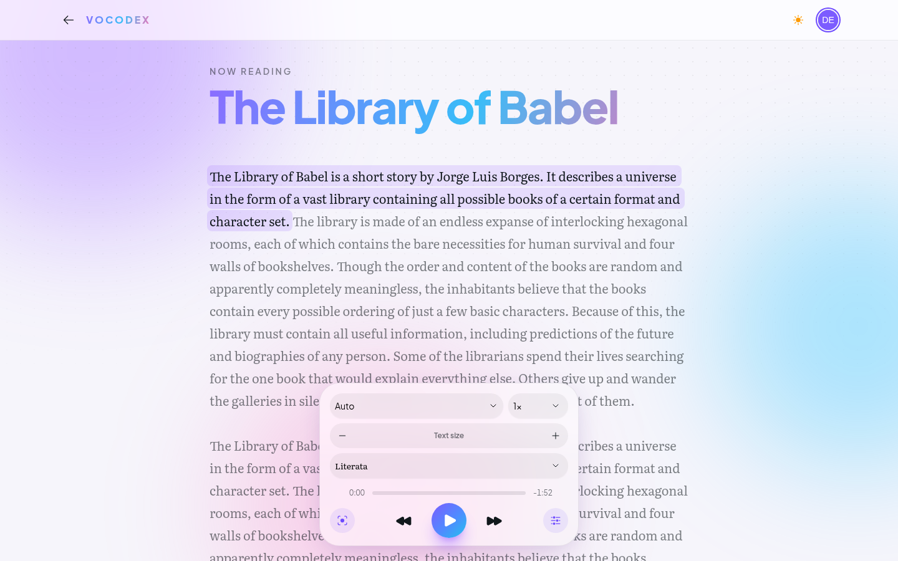
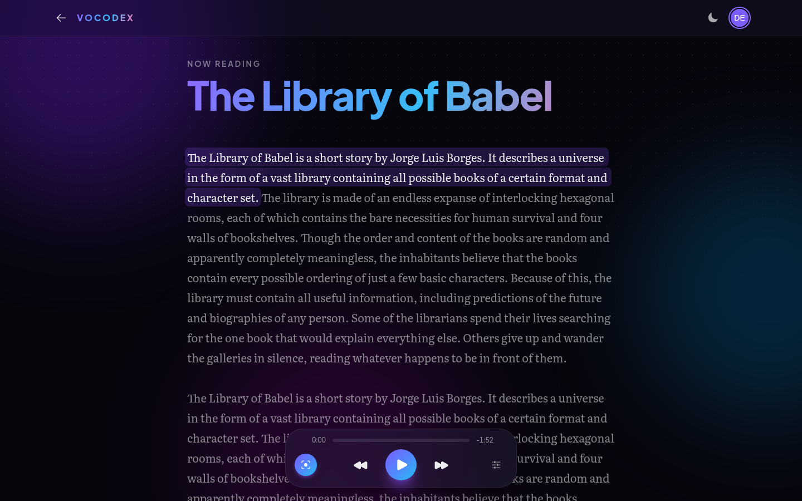
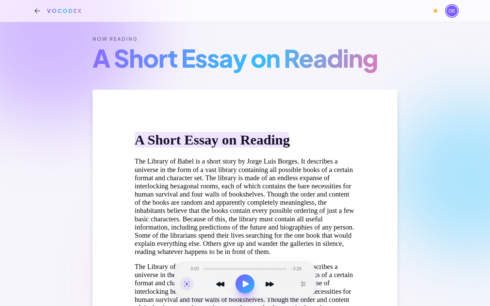
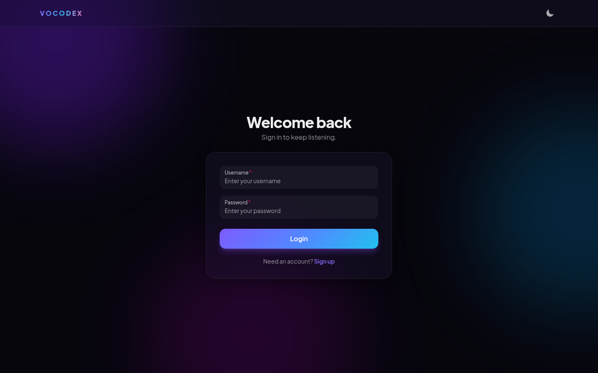
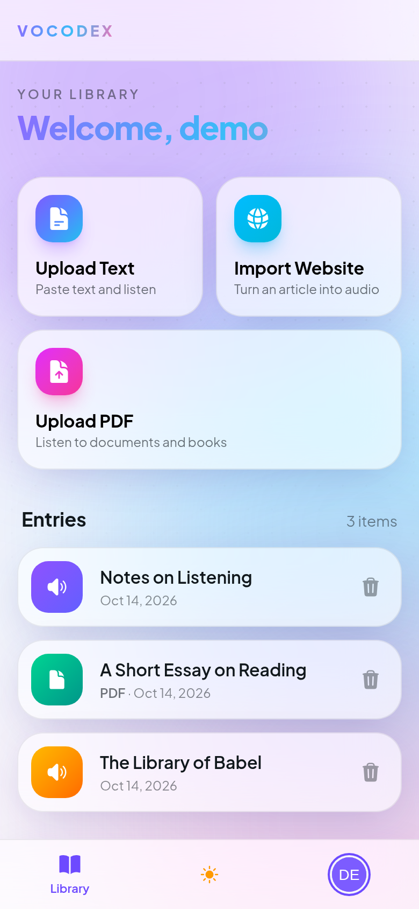
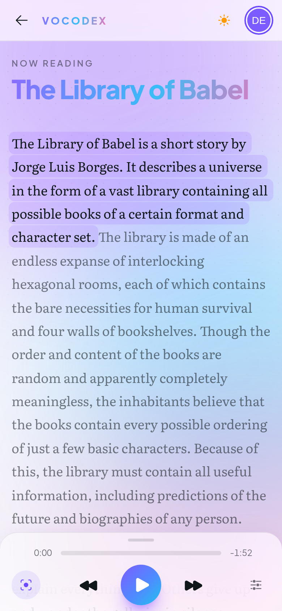
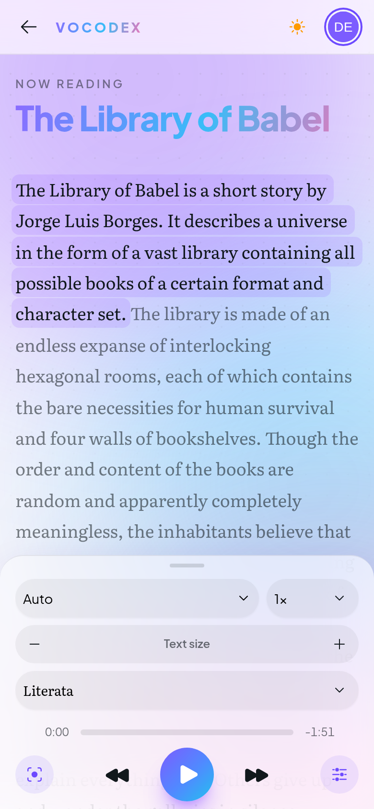
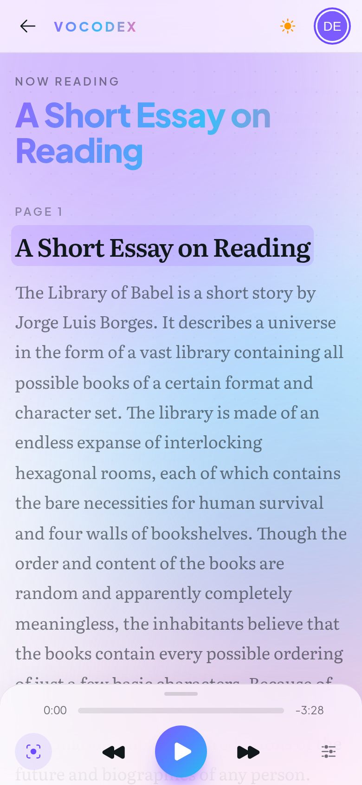

# VOCODEX

<div align="center">

[](https://opensource.org/licenses/MIT)


</div>

`VOCODEX` is a WIP self-hostable feature rich full fledged `TTS` client.
Its objective is to become a good open source and self-hosted alternative to premium services like `Speechify`.

Key features will be:
- Natural sounding voices
- User Friendliness
- Text Highlighting in sync with the voice
- Speed control
- `PDF` Reading
- Progress saving

Components:
- `Postgres` database
- Frontend using `React` and `TypeScript`
- Backend written in `Python` using `FastAPI`
- Browser extension for `Chromium` and `Firefox` that reads any web page aloud (see [`extension/`](extension/README.md))
- `edge-tts` package for the `TTS` feature (other `TTS` will be supported in the future)
- Fully Self-Hosted using `Docker compose`

## What Works Right Now

- Multi user
- Text uploading
- Website import: paste a URL and the article is turned into an entry
- `PDF` uploading and reading, page by page, with the original layout
- Text view for `PDF`s: read the extracted text, with headings and paragraphs, instead of the pages (easier on small screens)
- `EPUB` uploading: the book is read in chapter order, as text, with the same highlighting, fonts and progress saving as any text
- Speed control
- `TTS` with the full voice list from `edge-tts`, with search
- Text highlighting in sync with the voice, for plain text and `PDF`s, with the reader following along as it plays
- Current page of the total shown while reading a `PDF`
- Audio control (play, pause, forward, backward) with keyboard shortcuts too
- Keeps reading with the app minimized or the screen locked, with play, pause, next and previous on the lock screen and notification controls
- Font size control, and zoom for `PDF` pages, saved per mode in the user preferences
- Light and dark theme
- Mobile app-style layout with a compact player bar and an options panel for voice, speed and text size
- Installable as an app (`PWA`)

## Screenshots

### Desktop

| Library | Reader |
| --- | --- |
|  |  |

| Player options | Dark theme |
| --- | --- |
|  |  |

| PDF reader | Login |
| --- | --- |
|  |  |

### Mobile

| Library | Reader | Player options | PDF text view |
| --- | --- | --- | --- |
|  |  |  |  |

## Prerequisites

- Docker with compose plugin
- Git for repo cloning

## Setup
```bash
# Clone this repository
git clone https://github.com/c043/vocodex
cd vocodex

# Create a .env file and mimic the .env.example with your personal data like
# the ip of your server and your personal secret for the backend
# In the .env you can also change the frontend and backend ports 
# (Remember to change the backend port for the VITE_API_URL variable too if you
# change it though!)
# Edit the database username and password if you want (you cannot change them later)
vim .env

# .env.example
# Backend
POSTGRES_USER=admin
POSTGRES_PASSWORD=admin
POSTGRES_DB=vocodex
PGPORT=5432
BACKEND_PORT=8000
FRONTEND_PORT=3000
JWT_SECRET=<your-backend-secret-here>
JWT_EXPIRES=604800

# Frontend
# For production, set this to your public backend URL (e.g., http://your-server-ip:8000)
# This URL is baked into the frontend build at compile time
VITE_API_URL=http://localhost:8000

# Start the application
sudo docker compose -f docker-compose.prod.yml up -d --build
```

If everything went according to plan, going to `http://<server-ip>:<frontend-port-setted-in-.env>` should access the login page.

## In The Future

- Right now I'm using `edge-tts` to have natural sounding voices easily from the start. In the future I intend to implement support for multiple open source and self hosted `TTS`.
- `iOS` app

## Development Setup
```bash
git clone https://github.com/c043/vocodex
cd vocodex

# This command will bring up the development version of the application with 
# pgadmin too. You will be able to access pgadmin through http://localhost:5050
# with the credentials setted in the docker-compose.yml
sudo docker compose up
```

### How to test the backend
Once the server is running with `docker compose`, this command will test the backend
```bash
sudo docker compose exec backend pytest
```

### How to test the frontend
```bash
cd frontend
npx vitest --run
npm run typecheck
```

### How to build the browser extension
The extension in `extension/` stands on its own, it does not need the rest of
the project:
```bash
cd extension
npm install
npm run build   # .output/chrome-mv3 and .output/firefox-mv2
```
See [`extension/README.md`](extension/README.md) to load it in the browser and
package it for the stores.

### How to test the browser extension
```bash
cd extension
npx vitest --run
npm run typecheck
```

### API Documentation
FastAPI automatically generates interactive API documentation. Once the backend is running, you can access:
- Swagger UI at `http://localhost:8000/docs` for interactive API testing
- ReDoc at `http://localhost:8000/redoc` for API reference documentation
- OpenAPI schema at `http://localhost:8000/openapi.json` for the machine-readable specification

## Contributing

We welcome contributions! Please see our [Contributing Guidelines](CONTRIBUTING.md) for details on how to get started.

All contributors are expected to follow our [Code of Conduct](CODE_OF_CONDUCT.md).

## License

This project is licensed under the MIT License - see the [LICENSE](LICENSE) file for details.
